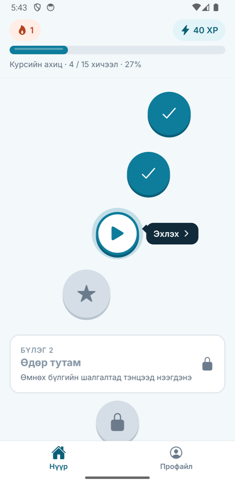
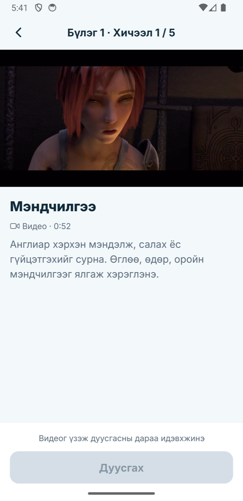
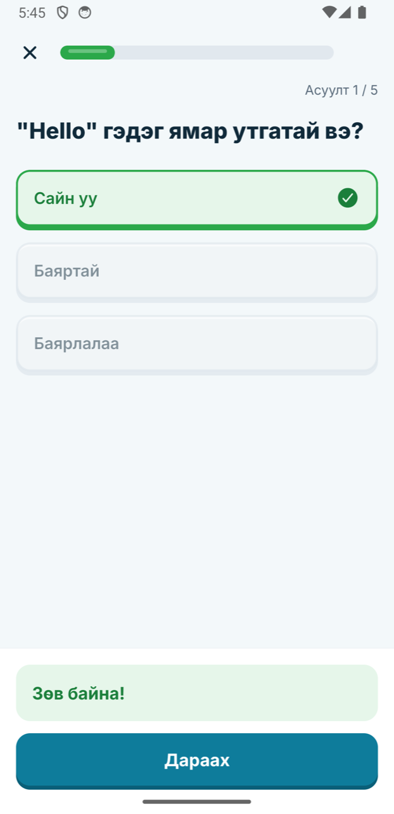
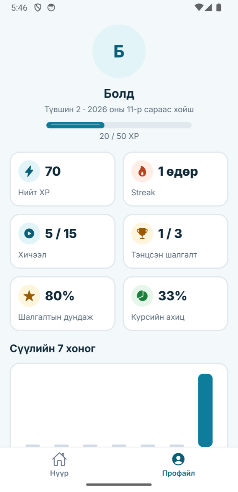

# OctoLearn: видео хичээлийн апп (prototype)

Duolingo-гийн зам шиг дарааллаар нээгддэг богино видео хичээл, 5 хичээл тутмын шалгалт, XP, streak, түвшин бүхий гар утасны апп. Expo (React Native) + TypeScript дээр хөгжүүлэв. Backend шаардлагагүй: контент нь аппад багтсан JSON, ахиц нь төхөөрөмж дээр хадгалагдана.

| Нүүр                                  | Хичээл                                    | Шалгалт                                  | Үр дүн                                    | Профайл                                     |
| ------------------------------------- | ----------------------------------------- | ---------------------------------------- | ----------------------------------------- | ------------------------------------------- |
|  |  |  |  |  |

## Татаж туршиж үзэх

| Юу                        | Холбоос                                                                                                                               |
| ------------------------- | ------------------------------------------------------------------------------------------------------------------------------------- |
| Android APK (100 MB)      | [octolearn.apk татах](https://expo.dev/artifacts/eas/YXGrwroCWjrBnTb025kSDqkc2C14KClUW_UG-GoapSY.apk)                                 |
| Демо видео (2:32, дуугүй) | [octolearn-demo.mp4](https://github.com/uno-b/octolearn-mobile/releases/download/v1.0.0/octolearn-demo.mp4) (repo-д эрх шаардлагатай) |

## Ажиллуулах заавар

Шаардлага: Node.js 22.13+ (эсвэл 24.3+), Yarn 1.22, Android төхөөрөмж эсвэл emulator дээрх [Expo Go](https://expo.dev/go) (SDK 58).

```bash
git clone https://github.com/uno-b/octolearn-mobile.git
cd octolearn-mobile
yarn install
yarn start
```

| Команд                                                  | Зорилго                                                        |
| ------------------------------------------------------- | -------------------------------------------------------------- |
| `yarn check`                                            | TypeScript, ESLint, Jest тестийг ажиллуулна                    |
| `yarn test`                                             | Зөвхөн тестүүд                                                 |
| `yarn check:videos`                                     | `course.json` доторх бүх видео холбоос ажиллаж байгааг шалгана |
| `npx eas-cli@latest build -p android --profile preview` | APK-г EAS Build дээр бүтээнэ                                   |

## Технологи

| Хэсэг      | Сонголт                                             | Шалтгаан                                                     |
| ---------- | --------------------------------------------------- | ------------------------------------------------------------ |
| Суурь      | Expo SDK 58, React Native 0.88, TypeScript (strict) | Нэг кодоор Android ба iOS, EAS-аар cloud дээр build хийнэ    |
| Navigation | Expo Router                                         | File-based routing, login protection via Stack.Protected.    |
| Төлөв      | Zustand + `persist`, AsyncStorage                   | Бага код, Redux шиг нэмэлт бүтэц шаардахгүй                  |
| Видео      | expo-video                                          | Native тоглуулагч: зогсоох, гүйлгэх, бүтэн дэлгэц бэлэн ирнэ |
| Анимэйшн   | react-native-reanimated, expo-haptics               | Confetti-г гадны файлгүйгээр бичсэн, лицензийн асуудалгүй    |
| Фонт       | Inter                                               | Монгол кирилл (Ө, Ү) бүрэн дэмждэг                           |
| Тест       | Jest (jest-expo)                                    | Бизнес logic шууд шалгана                                    |

## Архитектур ба гол шийдвэрүүд

```
src/
  app/          Зөвхөн routing ба дэлгэцүүд
  domain/       Цэвэр TypeScript: түгжээ, XP, streak, оноо. React, Expo импортгүй, бүрэн тесттэй
  store/        Zustand store: domain функцүүдийг дуудаж, үр дүнг AsyncStorage-д хадгална
  hooks/        Store ба тоглуулагчийг React-тай холбоно
  components/   Reusable UI: Button, PathNode, OptionCard, Celebration г.м
  content/      course.json ба түүний төрөл
  theme/        Өнгө, фонт, зайн токенууд
  i18n/mn.ts    Бүх монгол текст нэг дор
```

## Хийсэн зүйлс

| Түвшин | Зүйл                                                                               |
| ------ | ---------------------------------------------------------------------------------- |
| P0     |                                                                                    |
| P0     | Прогресс бар, нийт XP                                                              |
| P0     | Видео: тоглуулах, зогсоох, гүйлгэх, 90% дүрэм, "+10 XP" feedback                   |
| P0     | MCQ шалгалт, ногоон/улаан хариу, үр дүн, дахин өгөх                                |
| P0     | Профайлын статистик, доод навигаци, ахиц хадгалалт                                 |
| P1     | Идэвхтэй хичээл рүү автоматаар гүйлгэх, streak, түвшин                             |
| P1     | Бүтэн дэлгэц, анимэйшнтэй прогресс бар, reset товч                                 |
| P2     | Reanimated анимэйшн, өөрөө бичсэн confetti, чичиргээний feedback                   |
| P2     | Долоо хоногийн идэвхийн график                                                     |
| P2     | Mock нэвтрэлт (нэр оруулах дэлгэц)                                                 |
| P2     | Jest unit тест (domain ба store)                                                   |
| P2     | Сүлжээ тасрах үеийн зохицуулалт: алдааны дэлгэц, дахин оролдох, нөөц видео холбоос |
| P2     | Цэвэр архитектур, state management (Zustand)                                       |

## AI хэрэглээ

Хөгжүүлэлтийг голчлон Claude Code ашиглан хийсэн.

## Эх сурвалж ба лиценз

- Video: [Sintel](https://durian.blender.org/) ба [Big Buck Bunny](https://peach.blender.org/) (Blender Foundation, CC BY), [test-videos.co.uk](https://test-videos.co.uk/), [samplelib.com](https://samplelib.com/), ExoPlayer-ийн тестийн бичлэг.
- App octopus icon: [Noto Emoji](https://github.com/googlefonts/noto-emoji) (Apache-2.0).
- Font: [Inter](https://rsms.me/inter/) (SIL Open Font License).
